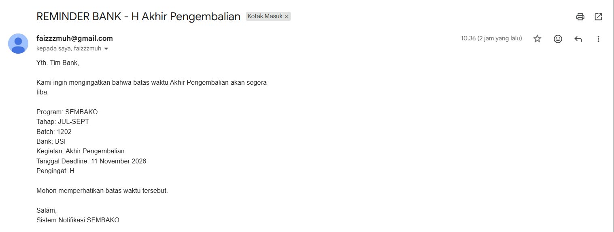
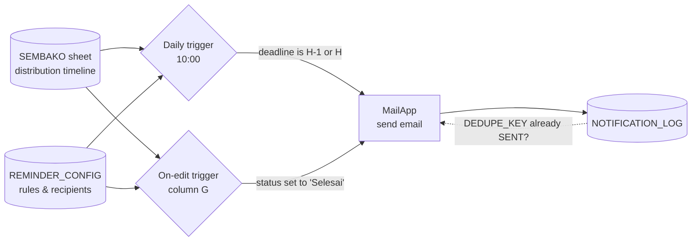
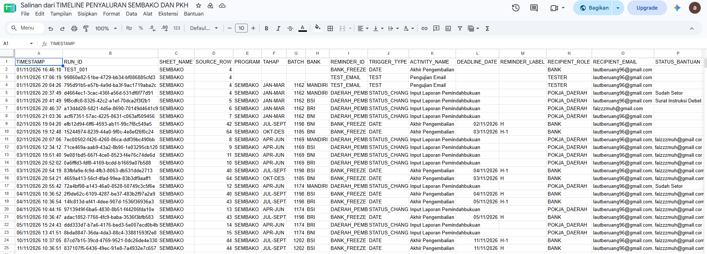

# 📬 Bansos Distribution Reminder: Google Sheets → Email Automation

> A **Google Apps Script** prototype that watches a social-assistance (*bansos*) distribution timeline in Google Sheets and **emails the right people at the right time**: it reminds partner **banks** before the fund-return deadline, and notifies the **regional working group** as soon as a bank's transfer report is marked complete. Every send is logged and protected against duplicates.

> ℹ️ **Prototype with fictional data.** I built it for a friend who monitors bansos distribution, to present to their supervisor. It is **not** an official government system, and all programs, batches, dates and email addresses in this repository are made up.

---

## 📌 Context

| | |
|---|---|
| **User** | A staff member who monitors bansos distribution (SEMBAKO program) |
| **Period** | November 2026 |
| **Role** | Sole developer: data model, script, testing and documentation |
| **Stack** | Google Sheets, Google Apps Script (V8), MailApp, installable triggers |

## ❓ Problem

After the government transfers bansos funds to partner banks, each batch follows a strict timeline: transfer report → utilization period → bank report → review → **freeze & debit** → **fund return**. Tracking dozens of batches across four banks by hand led to two recurring risks:

1. **Missed deadlines.** If funds aren't collected and the deadline passes, beneficiary accounts can be **frozen** and the beneficiary can lose eligibility for the next round.
2. **Slow follow-up.** The regional working group (*Pokja Daerah*) had to keep checking the sheet to see when a bank's transfer report was complete.

## ⚙️ How It Works

| Rule (`REMINDER_ID`) | Trigger | When it fires | Recipient |
|---|---|---|---|
| `BANK_FREEZE` | `DATE`, daily at 10:00 | **1 day before** and **on the day** of the fund-return deadline (column R) | Partner bank |
| `DAERAH_PEMBUKUAN` | `STATUS_CHANGE`, on edit | When the transfer-report status (column G) is changed to **Selesai** | Regional working group |

## ✨ Features

- **Rules live in the spreadsheet, not the code.** `REMINDER_CONFIG` holds recipients, reminder days (e.g. `1,0`), status values and subject prefixes, so non-programmers can change them.
- **Configuration check.** `validasiKonfigurasi()` flags missing sheets, invalid emails or incomplete rules before anything is sent.
- **No duplicate emails.** Each notification gets a `DEDUPE_KEY` built from program, stage, batch, bank, rule, label and deadline. A key that is already logged as `SENT` is skipped.
- **Safe under concurrency.** `LockService` makes sure two runs can't send the same email at once.
- **Full audit trail.** Every attempt is written to `NOTIFICATION_LOG` with timestamp, run ID, source row, recipient, status (`SENT` / `FAILED`) and error message.
- **Timezone-correct day counting.** Deadlines are compared as calendar dates in the spreadsheet's timezone, so H-1 and H don't drift around midnight.
- **Safe testing.** `simulasiPengingatBank()` does a dry run that lists candidates without sending, and the single-row test only runs when the recipient is the test address.

## 🗂️ Spreadsheet Structure

| Sheet | Contents |
|---|---|
| `SEMBAKO` | One row per program × stage × batch × bank (data starts at row 4). Column F holds the bank's transfer-report date; columns H–S compute the rest of the timeline with formulas (e.g. utilization ends +30 days, fund return at +70 days). Column G holds the report status, column T the aid status. |
| `REMINDER_CONFIG` | `ACTIVE`, `SHEET_NAME`, `REMINDER_ID`, `TRIGGER_TYPE`, `ACTIVITY_NAME`, `DATE_COLUMN`, `RECIPIENT_ROLE`, `RECIPIENT_EMAIL`, `REMINDER_DAYS`, `STATUS_COLUMN`, `STATUS_VALUE`, `SUBJECT_PREFIX` |
| `NOTIFICATION_LOG` | Send history used for auditing and duplicate prevention |

A ready-to-use copy with fictional data is in [`sample-data/`](sample-data/TIMELINE_PENYALURAN_SEMBAKO_sample.xlsx).

## ▶️ Setup

1. Upload `sample-data/TIMELINE_PENYALURAN_SEMBAKO_sample.xlsx` to Google Drive, open it, and choose **File → Save as Google Sheets**.
2. Open **Extensions → Apps Script**, then paste in [`src/Code.gs`](src/Code.gs). Optionally replace the project settings with [`src/appsscript.json`](src/appsscript.json).
3. Set `TEST_EMAIL` at the top of `Code.gs`, and put your own address in `REMINDER_CONFIG → RECIPIENT_EMAIL`.
4. Run `validasiKonfigurasi()` and `simulasiPengingatBank()` and check the execution log. Approve the permission prompt on the first run.
5. Run `pasangTriggerEdit()` and `pasangTriggerPengingatBank()` once to install the triggers.
6. To test: change a status in column G to **Selesai**, or set a transfer-report date so the fund-return deadline falls on today or tomorrow.

## 🧪 Testing

I tested the prototype end to end with fictional data. Status-change notifications, H-1 and H bank reminders, and test emails were all logged as `SENT`, and re-running the same rows was correctly skipped as a duplicate.

| Bank reminder email | Notification log |
|---|---|
|  |  |

## 🔍 Limitations

- `MailApp` has a daily sending quota (about 100 recipients per day on a free Google account).
- On-edit triggers fire only for manual edits, not for values pasted in by other scripts or imports.
- Date cells must be real dates. Dates typed as text are skipped by the daily reminder.
- The label logic assumes reminder days of `1` (H-1) and `0` (H).

## 🚀 Roadmap (if the prototype moves forward)

- **WhatsApp notifications** alongside email
- **Beneficiary notifications** when aid is ready to be collected
- A **real-time public dashboard** to monitor bansos distribution

## 💡 What I Learned

- Turning a manual monitoring routine into **clear, configurable rules**
- Designing for **reliability**: idempotent sends, locking and logging matter as much as the email itself
- Building **test and dry-run functions** so a system that emails real institutions can be checked safely

---

↩️ Back to [my profile](https://github.com/gencWeze)
